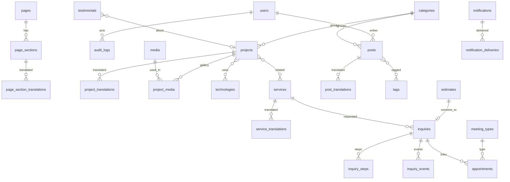

# Database — AMB Personal Portfolio

وضعیت: پیش‌نویس Phase 0 | نسخه: 0.1
این سند ساختار کامل دیتابیس را تعریف می‌کند. همه موجودیت‌های پرامپت اصلی (بخش 17) بدون حذف یا ادغام حفظ شده‌اند. جدول‌های اضافه فقط وقتی آمده‌اند که یک نیاز صریح پرامپت (CMS، رزومه، تخمین هزینه، رزرو، SEO، اعلان) بدون آن‌ها قابل پیاده‌سازی نیست و هر کدام با علامت «اضافه» مشخص شده است.

## 1. قراردادها

| مورد | قرارداد |
|---|---|
| موتور/Collation | InnoDB، `utf8mb4` با `utf8mb4_unicode_ci` (بررسی سازگاری MySQL/MariaDB در probe) |
| کلید اصلی | `id` BIGINT UNSIGNED خودافزا |
| شناسه عمومی | `public_id` ULID (CHAR(26)) برای موجودیت‌هایی که در URL یا ایمیل به مشتری داده می‌شوند (درخواست، رزرو، تخمین) |
| زمان | ستون‌های `*_at` از نوع DATETIME/TIMESTAMP به UTC؛ تاریخ‌های تقویمی (شروع/پایان سابقه) DATE |
| وضعیت‌ها | VARCHAR با Enum PHP (نه ENUM دیتابیس) تا تغییر آسان باشد؛ Index روی ستون وضعیت |
| ترجمه | جدول `<entity>_translations` با `(entity_id, locale)` یکتا؛ Slug یکتا روی `(locale, slug)` |
| انتشار | `status` (`draft`, `scheduled`, `published`, `archived`) + `published_at`؛ ترجمه‌ها وضعیت انتشار مستقل دارند |
| Soft Delete | فقط روی رکوردهای تجاری که بازیابی‌شان معنا دارد: projects, services, posts, testimonials, inquiries, appointments, media |
| Demo | ستون `is_demo` BOOLEAN روی محتوای قابل جایگزینی؛ فیلتر و حذف گروهی از پنل |
| ممیزی ایجاد | `created_by`, `updated_by` (FK به users، nullable، `SET NULL`) روی محتوای مدیریتی |
| جست‌وجوی فارسی | ستون `search_text` نرمال‌شده (ی/ک، ارقام، ZWNJ، فاصله‌ها، حروف کوچک) روی ترجمه‌های قابل جست‌وجو؛ جست‌وجو با `LIKE`/Fulltext روی همین ستون |
| پول | مقادیر تخمین به‌صورت عدد صحیح در کوچک‌ترین واحد ارز؛ واحد ارز در `settings` (قابل تأیید مالک) |
| JSON | فقط برای داده ساختاریافته و کم‌پرس‌وجو (مراحل، FAQ، Snapshot)؛ پرس‌وجوهای پرتکرار ستون جدا دارند |
| داده خصوصی | جدول‌ها و ستون‌های خصوصی در بخش 15 فهرست شده‌اند؛ هرگز در Resource عمومی نمی‌آیند |

حذف کاسکید: ترجمه‌ها و Pivotها `ON DELETE CASCADE`؛ ارجاع به کاربر `SET NULL`؛ ارجاع به رسانه `SET NULL`؛ ارجاع به رکوردهای تجاری مهم (مثل `inquiries.service_id`) `RESTRICT` یا `SET NULL` طبق جدول.

## 2. نمای کلی دامنه‌ها

| دامنه | جدول‌ها |
|---|---|
| هویت و دسترسی | users, roles, permissions (+ جداول Pivot پکیج), password_reset_tokens, sessions |
| محتوا و CMS | pages (اضافه), page_translations (اضافه), page_sections, page_section_translations, settings, setting_translations (اضافه), social_links, social_link_translations (اضافه) |
| نمونه‌کار | projects, project_translations, project_media, technologies (اضافه), project_technology (اضافه), service_project (اضافه) |
| خدمات | services, service_translations |
| وبلاگ | posts, post_translations, categories, category_translations (اضافه), tags, tag_translations (اضافه), post_tag, post_comments (شرطی) |
| رسانه | media, media_translations (اضافه) |
| رزومه | experiences, experience_translations (اضافه), skills, skill_translations (اضافه), certifications, certification_translations (اضافه), educations (اضافه), education_translations (اضافه), achievements (اضافه), achievement_translations (اضافه) |
| نظرات | testimonials, testimonial_translations (اضافه) |
| جذب مشتری | inquiries, inquiry_steps, inquiry_events, estimator_rules (اضافه), estimator_rule_translations (اضافه), estimates (اضافه), contact_messages (اضافه) |
| رزرو | appointments, meeting_types (اضافه), meeting_type_translations (اضافه), availability_rules (اضافه), availability_exceptions (اضافه) |
| اعلان‌ها | notifications, notification_deliveries (اضافه) |
| SEO | redirects (اضافه) |
| زیرساخت | audit_logs, api_snapshots (اضافه), jobs, failed_jobs, cache, cache_locks, migrations |

## 3. هویت و دسترسی

### users
مسئولیت: حساب مدیر، ویراستار و (در آینده) مشتری.

| ستون | نوع | توضیح |
|---|---|---|
| id | bigint PK | |
| name | varchar(120) | |
| email | varchar(190) unique | نرمال‌شده (کوچک) |
| email_verified_at | datetime null | |
| password | varchar(255) | Hash |
| phone | varchar(32) null | نرمال‌شده |
| locale | varchar(5) default `fa` | زبان ترجیحی پنل/اعلان |
| is_active | boolean default true | |
| last_login_at | datetime null | |
| remember_token | varchar(100) null | |
| created_at, updated_at | | |

روابط: `hasMany` به posts (author)، audit_logs، notifications (polymorphic)، model_has_roles. Index: `email` unique، `is_active`.

### roles / permissions
جدول‌های پکیج `spatie/laravel-permission`: `roles`, `permissions`, `model_has_roles`, `model_has_permissions`, `role_has_permissions`. نقش‌های اولیه: `admin`, `editor`، و رزرو برای `client` (فعال‌سازی در فاز آینده). مجوزها بر اساس ماژول و عمل (`projects.create`, `posts.publish`, `inquiries.view`, ...).

### password_reset_tokens, sessions
استاندارد Laravel. `sessions` در صورت انتخاب driver دیتابیس؛ Index روی `user_id` و `last_activity`.

## 4. CMS، صفحات و تنظیمات

### pages (اضافه)
مسئولیت: صفحات ثابت (home, about, resume, contact, privacy, terms) و مبنای بخش‌های صفحه اصلی.

| ستون | توضیح |
|---|---|
| id | |
| key | varchar(60) unique (`home`, `about`, `resume`, `contact`, `privacy`, `terms`, ...) |
| template | varchar(60) (قالب Blade مربوطه) |
| status | `draft/published/...` |
| is_system | boolean (صفحات سیستمی غیرقابل حذف) |
| show_in_nav, show_in_footer | boolean |
| sort_order | int |
| published_at | datetime null |
| created_by, updated_by | FK null |
| timestamps | |

### page_translations (اضافه)
`page_id` FK cascade، `locale`، `slug`، `title`، `body` (HTML پاک‌سازی‌شده، nullable)، `meta_title`، `meta_description`، `og_media_id` FK media null، `canonical_override` null، `robots` (`index,follow` پیش‌فرض)، `status` (وضعیت انتشار آن زبان)، `search_text`. یکتا: `(page_id, locale)` و `(locale, slug)`.

### page_sections
مسئولیت: بخش‌های قابل چینش صفحه اصلی و صفحات دیگر (ترتیب، نمایش، تنظیمات).

| ستون | توضیح |
|---|---|
| id | |
| page_id | FK pages cascade |
| type | varchar(60): `hero, intro, services, projects, stats, process, skills, github, testimonials, posts, cta, custom` |
| position | int (ترتیب) |
| is_visible | boolean |
| config | json (مثلاً تعداد آیتم، فقط منتخب‌ها، Variant ظاهری) |
| is_demo | boolean |
| timestamps | |

Index: `(page_id, position)`.

### page_section_translations
`page_section_id` FK cascade، `locale`، `heading`، `subheading`، `body` null، `cta_label`، `cta_url`، `extra` json (آیتم‌های سفارشی). یکتا `(page_section_id, locale)`.

### settings
| ستون | توضیح |
|---|---|
| id | |
| group | varchar(60) (`general`, `contact`, `seo`, `social`, `notifications`, `booking`, `estimator`, `appearance`) |
| key | varchar(120) |
| value | text/json null |
| type | `string, int, bool, json, secret_ref` |
| is_public | boolean (قابل نمایش در سایت) |
| is_translatable | boolean |
| timestamps | |

یکتا `(group, key)`. Secret ها (کلید API) **هرگز** در این جدول نیستند؛ فقط در `.env`.

### setting_translations (اضافه)
`setting_id` FK cascade، `locale`، `value`. یکتا `(setting_id, locale)`. برای نام سایت، شعار، متن Footer و غیره.

### social_links
`id`, `platform` (`github, linkedin, telegram, instagram, x, email, ...`), `url`, `icon` (نام آیکون Sprite)، `sort_order`, `is_visible`, `show_in_footer`, `show_in_contact`, `is_demo`, timestamps.

### social_link_translations (اضافه)
`social_link_id` FK cascade، `locale`، `label`. یکتا `(social_link_id, locale)`.

## 5. نمونه‌کارها

### projects
| ستون | توضیح |
|---|---|
| id | |
| category_id | FK categories null (SET NULL) — دسته از نوع `project` |
| status | وضعیت انتشار کلی |
| is_featured | boolean |
| sort_order | int |
| started_on, completed_on | DATE null (فقط داده معتبر) |
| duration_note | varchar null (مدت اجرا فقط در صورت اطلاعات معتبر) |
| live_url, repo_url | varchar(500) null (اعتبارسنجی `http/https`) |
| client_name | varchar(160) null |
| show_client | boolean default false |
| cover_media_id | FK media null SET NULL |
| is_demo | boolean |
| published_at | datetime null |
| created_by, updated_by | FK null |
| timestamps, deleted_at | |

Index: `(status, published_at)`, `(is_featured, sort_order)`, `category_id`.

### project_translations
`project_id` FK cascade، `locale`، `slug`، `title`، `summary`، `problem`، `goals`، `role`، `process` (HTML/Markdown پاک‌سازی‌شده)، `challenges` (json: لیست چالش/راه‌حل)، `results` (nullable؛ فقط داده واقعی)، `meta_title`، `meta_description`، `og_media_id` null، `robots`، `status`، `published_at` null، `search_text`. یکتا `(project_id, locale)` و `(locale, slug)`.

### project_media
جدول رابطه گالری: `id`, `project_id` FK cascade, `media_id` FK media cascade, `role` (`cover, gallery, detail, video_poster`), `sort_order`. یکتا `(project_id, media_id, role)`. متن Alt و عنوان از `media_translations`.

### technologies (اضافه)
`id`, `slug` unique, `name` (نام خاص، ترجمه‌ناپذیر)، `icon` null (آیکون Sprite)، `url` null، `sort_order`, timestamps. برای برچسب فناوری‌های پروژه و فیلتر نمونه‌کار.

### project_technology (اضافه)
Pivot: `project_id`, `technology_id` (کلید ترکیبی، FK cascade).

### service_project (اضافه)
Pivot: `service_id`, `project_id` (کلید ترکیبی، FK cascade) برای «نمونه‌کارهای مرتبط با خدمت».

## 6. خدمات

### services
`id`, `status`, `is_featured`, `sort_order`, `icon` (نام آیکون)، `published_at`, `is_demo`, `created_by`, `updated_by`, timestamps, deleted_at. Index: `(status, sort_order)`.

### service_translations
`service_id` FK cascade، `locale`، `slug`، `title`، `summary`، `intro`، `problem`، `solution`، `process` (json: مراحل `{title, description}`)، `deliverables` (json: لیست خروجی‌ها)، `faq` (json: `{question, answer}`)، `cta_label`، `meta_title`، `meta_description`، `og_media_id`، `robots`، `status`، `search_text`. یکتا `(service_id, locale)` و `(locale, slug)`.

نکته: `process`, `deliverables`, `faq` JSON با Schema اعتبارسنجی‌شده سمت سرور و ویرایش با Repeater پنل؛ چون پرس‌وجوی جداگانه ندارند. اگر نیاز به گزارش یا SEO پیشرفته FAQ پیدا شد، به جدول جدا ارتقا می‌یابد.

## 7. وبلاگ

### categories
`id`, `type` (`post`, `project`), `parent_id` null (خود-ارجاع، SET NULL)، `sort_order`, `is_demo`, timestamps. Index: `(type, sort_order)`.

### category_translations (اضافه)
`category_id` FK cascade، `locale`، `slug`، `name`، `description`، `meta_title`، `meta_description`. یکتا `(category_id, locale)` و `(locale, slug)`.

### tags
`id`, `is_demo`, timestamps.

### tag_translations (اضافه)
`tag_id` FK cascade، `locale`، `slug`، `name`. یکتا `(tag_id, locale)` و `(locale, slug)`.

### posts
`id`, `author_id` FK users (SET NULL)، `category_id` FK categories (SET NULL)، `status`, `is_featured`, `allow_comments` (پیش‌فرض false)، `cover_media_id` null، `published_at`, `scheduled_at`, `is_demo`, `created_by`, `updated_by`, timestamps, deleted_at. Index: `(status, published_at)`, `category_id`, `author_id`.

### post_translations
`post_id` FK cascade، `locale`، `slug`، `title`، `excerpt`، `body` (LONGTEXT، HTML پاک‌سازی‌شده TipTap)، `toc` json null (فهرست مطالب تولیدشده هنگام ذخیره)، `reading_minutes` smallint، `meta_title`، `meta_description`، `og_media_id`، `robots`، `status`، `published_at` null، `search_text`. یکتا `(post_id, locale)` و `(locale, slug)`. Index: `(locale, status, published_at)`.

### post_tag
Pivot `post_id`, `tag_id` (کلید ترکیبی، FK cascade).

### post_comments (شرطی)
فقط اگر نظرات وبلاگ فعال شود (سؤال باز PRD)؛ در غیر این صورت Migration ساخته نمی‌شود. ستون‌ها: `id`, `post_id` FK cascade، `parent_id` null، `author_name`, `author_email` (خصوصی)، `body`، `status` (`pending, approved, spam, rejected`)، `ip_hash`, `locale`, timestamps. Index: `(post_id, status)`.

## 8. رسانه

### media
| ستون | توضیح |
|---|---|
| id | |
| disk | varchar(30) |
| path | varchar(500) (نام تصادفی) |
| original_name | varchar(255) (فقط متادیتا) |
| mime | varchar(120) (MIME واقعی) |
| extension | varchar(10) |
| kind | `image, document, video` |
| size | bigint (بایت) |
| width, height | int null |
| dominant_color | char(7) null (برای Placeholder) |
| hash | char(64) (SHA-256) Index |
| variants | json (نسخه‌های Responsive و فرمت‌ها) |
| is_public | boolean |
| uploaded_by | FK users null |
| timestamps, deleted_at | |

### media_translations (اضافه)
`media_id` FK cascade، `locale`، `alt`، `title`، `caption`. یکتا `(media_id, locale)`.

## 9. رزومه و تجربه

### experiences
`id`, `employment_type` (`full_time, freelance, contract, ...`), `started_on` DATE, `ended_on` DATE null, `is_current` boolean, `company_url` null, `sort_order`, `is_featured`, `is_demo`, `is_verified` boolean, timestamps.

### experience_translations (اضافه)
`experience_id` FK cascade، `locale`، `role_title`، `company_name`، `location`، `summary`، `highlights` (json لیست)، `search_text`. یکتا `(experience_id, locale)`.

### skills
`id`, `category` (`frontend, backend, wordpress, design, seo, tools, ...`), `technology_id` FK technologies null (SET NULL)، `level` tinyint null (1 تا 5 یا درصد؛ فقط با تأیید مالک)، `years` decimal null، `icon` null, `sort_order`, `is_featured`, `is_demo`, timestamps.

### skill_translations (اضافه)
`skill_id` FK cascade، `locale`، `name`، `description`. یکتا `(skill_id, locale)`.

### certifications
`id`, `issued_on` DATE null, `expires_on` DATE null, `credential_id` null, `credential_url` null, `file_media_id` FK media null (فایل مدرک؛ خصوصی/عمومی طبق `is_public`)، `is_public` boolean, `is_verified`, `is_demo`, `sort_order`, timestamps.

### certification_translations (اضافه)
`certification_id` FK cascade، `locale`، `title`، `issuer`، `description`. یکتا `(certification_id, locale)`.

### educations (اضافه)
`id`, `started_on` DATE null, `ended_on` DATE null, `is_current`, `sort_order`, `is_demo`, `is_verified`, timestamps.

### education_translations (اضافه)
`education_id` FK cascade، `locale`، `institution`، `degree`، `field`، `description`. یکتا `(education_id, locale)`.

### achievements (اضافه)
مسئولیت: «دوره‌ها و دستاوردها» و آمار شمارنده‌های صفحه اصلی (فقط داده معتبر).

`id`, `type` (`stat, award, course, milestone`), `value` decimal null (برای شمارنده)، `suffix` varchar(10) null، `achieved_on` DATE null, `url` null, `is_featured`, `is_verified`, `is_demo`, `sort_order`, timestamps.

### achievement_translations (اضافه)
`achievement_id` FK cascade، `locale`، `title`، `description`. یکتا `(achievement_id, locale)`.

## 10. نظرات مشتریان

### testimonials
`id`, `project_id` FK projects null (SET NULL)، `status` (`pending, approved, rejected`)، `source` (`admin, submitted`)، `author_name`، `author_avatar_media_id` null، `submitter_email` null (خصوصی)، `submitter_token_hash` null، `verification_note` text null (داخلی)، `is_featured`, `sort_order`, `approved_at`, `approved_by` FK users null, `is_demo`, timestamps, deleted_at. Index: `(status, is_featured)`.

### testimonial_translations (اضافه)
`testimonial_id` FK cascade، `locale`، `quote`، `author_role`، `author_company`، `status`. یکتا `(testimonial_id, locale)`.

قاعده: هیچ نظری بدون `status=approved` منتشر نمی‌شود؛ Structured Data امتیاز/Review ساختگی ساخته نمی‌شود.

## 11. درخواست‌های همکاری، تخمین و تماس

### inquiries
| ستون | توضیح |
|---|---|
| id | |
| public_id | ULID unique |
| tracking_code | varchar(16) unique (کد پیگیری خوانا) |
| idempotency_key | varchar(64) unique (جلوگیری از ثبت تکراری) |
| user_id | FK users null (آینده: مشتری ثبت‌نام‌شده) |
| locale | varchar(5) |
| source | `wizard, estimator, contact, booking` |
| status | `new, reviewing, contacted, quoted, won, lost, archived, spam` |
| priority | `low, normal, high` |
| name, email, phone, company | داده تماس (خصوصی) |
| service_id | FK services null (SET NULL) |
| budget_range, timeline | varchar null |
| estimate_id | FK estimates null (SET NULL)؛ به‌دلیل ارجاع دوطرفه با `estimates.converted_inquiry_id`، کلید خارجی یکی از دو طرف در Migration جداگانه و پس از ساخت هر دو جدول اضافه می‌شود |
| assigned_to | FK users null |
| consent_at | datetime null |
| ip_hash, user_agent_hash | char(64) null |
| utm | json null |
| submitted_at | datetime |
| timestamps, deleted_at | |

Index: `(status, submitted_at)`, `email`, `service_id`.

### inquiry_steps
`id`, `inquiry_id` FK cascade, `step_key` varchar(60), `step_index` tinyint, `data` json (پاسخ‌های مرحله)، `completed_at` datetime null, timestamps. یکتا `(inquiry_id, step_key)`. افزودن مرحله جدید = تعریف جدید در کد؛ بدون تغییر Schema.

### inquiry_events
`id`, `inquiry_id` FK cascade, `type` (`created, status_changed, note_added, assigned, email_sent, sms_sent, viewed, converted_from_estimate, appointment_linked`), `actor_id` FK users null, `payload` json null, `created_at`. Index: `(inquiry_id, created_at)`. فقط افزودنی (Append-only).

### estimator_rules (اضافه)
مسئولیت: قواعد محاسبه تخمین در یک محل مرکزی و قابل ویرایش.

`id`, `service_id` FK services null (null = عمومی)، `group` (`base, complexity, feature, timeline, addon`)، `key` varchar(80)، `type` (`fixed, multiplier, per_unit, range`)، `amount_min` bigint null, `amount_max` bigint null, `multiplier` decimal(6,3) null, `config` json null, `sort_order`, `is_active`, `version` int, timestamps. یکتا `(service_id, group, key, version)`.

### estimator_rule_translations (اضافه)
`estimator_rule_id` FK cascade، `locale`، `label`، `description`. یکتا `(estimator_rule_id, locale)`.

هیچ مقدار پولی بدون تأیید مالک Seed نمی‌شود؛ مقدارها فقط Placeholder با `is_demo` در تنظیمات یا ستون config.

### estimates (اضافه)
`id`, `public_id` ULID unique, `locale`, `input` json (انتخاب‌های کاربر)، `result` json (محدوده، جزئیات، هشدار «تخمین اولیه»)، `rules_version` int, `ip_hash` null, `converted_inquiry_id` FK inquiries null (SET NULL), `created_at`, `expires_at` null. برای تبدیل تخمین به درخواست همکاری و حفظ داده‌ها.

### contact_messages (اضافه)
`id`, `public_id`, `name`, `email`, `phone` null, `subject`, `message` text, `locale`, `status` (`new, read, replied, spam, archived`), `ip_hash`, `handled_by` FK users null, `handled_at` null, timestamps, deleted_at (اختیاری). Index: `(status, created_at)`.

## 12. رزرو جلسه

### meeting_types (اضافه)
`id`, `duration_minutes` smallint, `buffer_before`, `buffer_after` smallint, `is_active`, `sort_order`, `requires_approval` boolean, `max_days_ahead` smallint, `min_notice_hours` smallint, timestamps.

### meeting_type_translations (اضافه)
`meeting_type_id` FK cascade، `locale`، `name`، `description`. یکتا `(meeting_type_id, locale)`.

### availability_rules (اضافه)
`id`, `weekday` tinyint (0-6)، `start_time` TIME, `end_time` TIME, `timezone` varchar(64) (مثلاً `Asia/Tehran`)، `meeting_type_id` FK null، `is_active`. قواعد هفتگی زمان‌های در دسترس.

### availability_exceptions (اضافه)
`id`, `date` DATE, `type` (`closed, custom`), `start_time`, `end_time` null, `note` null, timestamps. تعطیلات و استثناها.

### appointments
| ستون | توضیح |
|---|---|
| id | |
| public_id | ULID unique |
| meeting_type_id | FK meeting_types |
| inquiry_id | FK inquiries null (SET NULL) |
| user_id | FK users null |
| starts_at, ends_at | datetime (UTC) |
| status | `pending, confirmed, cancelled, completed, no_show, rescheduled` |
| name, email, phone | خصوصی |
| notes | text null |
| locale | |
| manage_token_hash | char(64) (لینک امن لغو/تغییر) |
| cancelled_at, cancelled_by, cancel_reason | |
| reminder_sent_at | datetime null |
| slot_lock | ستون تولیدی (Generated، STORED): برابر `starts_at` فقط وقتی `status` در (`pending`, `confirmed`) باشد، وگرنه NULL |
| timestamps, deleted_at | |

جلوگیری از رزرو هم‌زمان:
1. تراکنش با `lockForUpdate` روی رزروهای فعال همان روز و بررسی هم‌پوشانی (برای مدت‌های متفاوت).
2. `UNIQUE(slot_lock)` به‌عنوان تور نهایی دیتابیسی (NULL ها مجاز و چندتایی)؛ در MariaDB/MySQL با Generated Column؛ سازگاری در probe تأیید شود، وگرنه جدول کمکی `appointment_slots` با کلید یکتای `starts_at`.
3. تست همزمانی اجباری (`guidelines.md`).

Index: `(status, starts_at)`, `email`, `meeting_type_id`.

## 13. اعلان‌ها

### notifications
اعلان‌های داخل پنل (ساختار استاندارد Laravel): `id` UUID PK, `type`, `notifiable_type`, `notifiable_id`, `data` json, `read_at`, timestamps. Index: `(notifiable_type, notifiable_id, read_at)`.

### notification_deliveries (اضافه)
مسئولیت: ثبت تحویل در کانال‌های بیرونی (ایمیل/پیامک) برای اتکاپذیری و گزارش.

`id`, `notification_id` UUID null, `channel` (`mail, sms, database`), `recipient` varchar(190) (ماسک‌شده در نمایش)، `template` varchar(80), `locale`, `payload` json null (بدون Secret)، `status` (`queued, sending, sent, failed, skipped`), `attempts` tinyint, `last_error` text null, `provider_message_id` null, `queued_at`, `sent_at` null, timestamps. Index: `(status, queued_at)`, `(channel, status)`.

## 14. SEO و زیرساخت

### redirects (اضافه)
`id`, `locale` varchar(5) null, `from_path` varchar(500) unique با Hash (`from_hash` char(64) برای یکتایی)، `to_path` varchar(500), `status_code` smallint (301/302/410)، `hits` int, `is_auto` boolean (ایجادشده هنگام تغییر Slug)، `is_active`, `created_by`, timestamps.

### audit_logs
| ستون | توضیح |
|---|---|
| id | bigint PK |
| user_id | FK users null (SET NULL) |
| event | `created, updated, deleted, published, login, logout, login_failed, permission_changed, setting_changed, installer_run, pii_viewed` |
| auditable_type, auditable_id | polymorphic null |
| old_values, new_values | json null (بدون رمز/Secret/PII حساس) |
| ip_hash | char(64) null |
| user_agent | varchar(255) null (کوتاه‌شده) |
| url | varchar(500) null |
| created_at | بدون `updated_at` (Append-only) |

Index: `(auditable_type, auditable_id)`, `(user_id, created_at)`, `(event, created_at)`.

### api_snapshots (اضافه)
`id`, `key` varchar(80) unique (`github_activity`, ...), `payload` json, `status` (`ok, error`), `error_message` null, `fetched_at`, `expires_at`. برای کش آخرین داده موفق GitHub با Fallback.

### جداول استاندارد Laravel
`jobs`, `failed_jobs`, `job_batches` (در صورت نیاز)، `cache`, `cache_locks`, `migrations`.

## 15. داده عمومی در برابر خصوصی

| دسته | جدول‌ها / ستون‌ها | قاعده |
|---|---|---|
| عمومی (فقط `published`) | pages، page_sections، services، projects، posts، categories، tags، skills، experiences، certifications (`is_public`)، educations، achievements، testimonials (`approved`)، social_links (`is_visible`)، settings (`is_public`)، media (`is_public`) | فقط از طریق Scope انتشار؛ Resource عمومی ستون‌های داخلی را نمی‌دهد |
| خصوصی | users، inquiries، inquiry_steps، inquiry_events، estimates، contact_messages، appointments، notification_deliveries، notifications، audit_logs، post_comments (ایمیل)، testimonials (`submitter_email`, `verification_note`)، certifications (فایل غیرعمومی)، api_snapshots، redirects | فقط پنل با Policy |
| ستون‌های PII | name/email/phone در inquiries، appointments، contact_messages؛ `ip_hash`/`user_agent_hash` | کمینه‌سازی، Retention، ماسک در UI و لاگ |

## 16. روابط اصلی (خلاصه)

## 17. Index و Constraint کلیدی (خلاصه)

| جدول | Constraint / Index |
|---|---|
| *_translations | UNIQUE `(entity_id, locale)`، UNIQUE `(locale, slug)` برای دارای Slug |
| posts / projects / services | INDEX `(status, published_at)`، FK ها با قاعده حذف مشخص |
| inquiries | UNIQUE `public_id`, `tracking_code`, `idempotency_key`؛ INDEX `(status, submitted_at)` |
| appointments | UNIQUE `slot_lock`؛ INDEX `(status, starts_at)` |
| redirects | UNIQUE `from_hash` |
| settings | UNIQUE `(group, key)` |
| post_tag / project_technology / service_project | کلید ترکیبی |
| audit_logs | INDEX `(auditable_type, auditable_id)`, `(user_id, created_at)` |
| media | INDEX `hash` |

## 18. Migration، Factory و Seeder

- ترتیب Migration: هویت، رسانه، دسته/برچسب/فناوری، محتوا (pages, services, projects, posts)، رزومه، نظرات، تخمین/درخواست، رزرو، اعلان، SEO، زیرساخت.
- هر Migration با `down()` و الگوی Expand/Contract (`deployment.md`).
- Factory برای همه مدل‌های محتوایی با ترجمه فارسی و انگلیسی و `is_demo = true`.
- Seeder اولیه: نقش‌ها و مجوزها، تنظیمات پایه، صفحات سیستمی، بخش‌های صفحه اصلی، دسته‌های وبلاگ، انواع جلسه Placeholder، قواعد تخمین Placeholder (بدون قیمت واقعی)، حساب مدیر فقط از Installer.
- Seeder داده Demo جدا از Seeder سیستمی و قابل اجرا/حذف از پنل.

## 19. جلوگیری از N+1 و کارایی

- `Model::preventLazyLoading()` در توسعه/تست.
- Eager Loading صریح برای ترجمه (`with(['translations' => fn ($q) => $q->where('locale', $locale)])`)، رسانه، دسته، فناوری.
- فهرست‌ها با `select` ستون‌های لازم و Pagination.
- کش فرگمنت‌های سنگین با ابطال هنگام انتشار.
- Index روی همه ستون‌های فیلتر/مرتب‌سازی عمومی.
- گزارش `EXPLAIN` برای Queryهای صفحه اصلی، فهرست نمونه‌کار، وبلاگ و پنل در Phase 3 و Phase 8.

## 20. تصمیم‌های باز دیتابیس

| # | موضوع | توضیح |
|---|---|---|
| 1 | `post_comments` | فقط اگر نظرات وبلاگ فعال شود |
| 2 | JSON یا جدول برای FAQ/مراحل خدمت | پیش‌فرض JSON؛ ارتقا در صورت نیاز |
| 3 | `slot_lock` Generated Column | وابسته به نسخه MySQL/MariaDB هاست (probe) |
| 4 | ارز و واحد تخمین | تأیید مالک |
| 5 | Retention داده‌های PII | تأیید مالک |
| 6 | سیاست SVG آپلودی | پیش‌فرض ممنوع |
